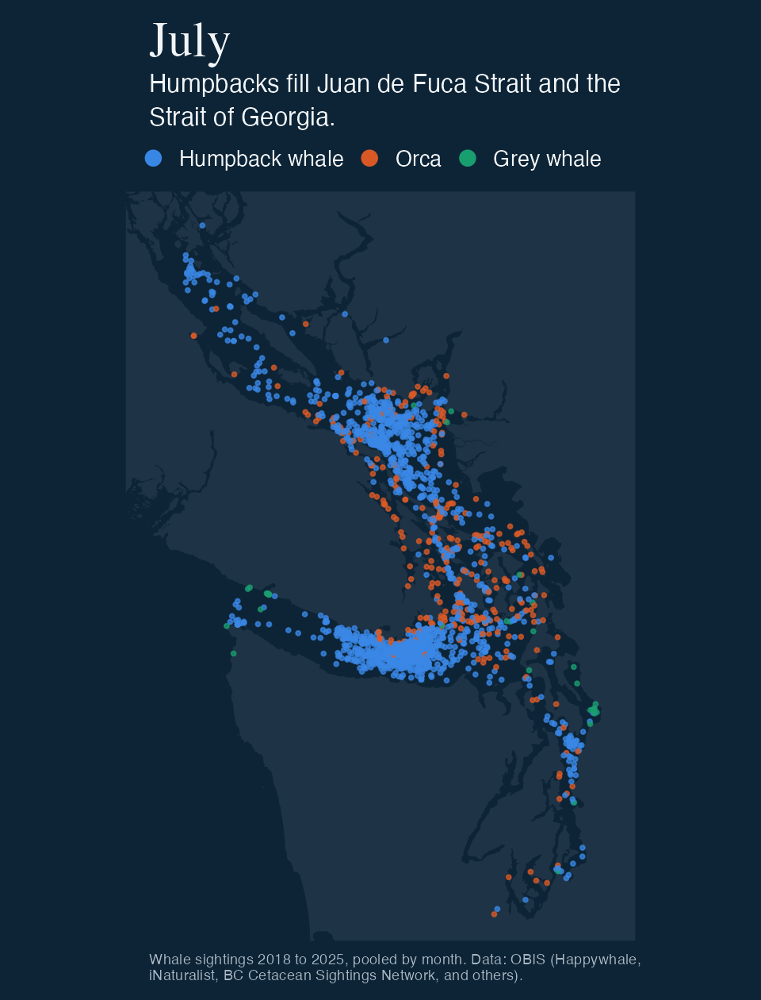

# Whales of the Salish Sea: more whales, or more watchers?

An interactive data story about humpback whales, orcas, and grey whales in the Salish Sea, and how much of the rise in sightings is really more people watching.

**Live site:** [emmabranch.github.io/salish-sea-whales](https://emmabranch.github.io/salish-sea-whales/) | **Code:** this repository | **More projects:** [github.com/emmabranch](https://github.com/emmabranch)

## What it does

- Downloads open occurrence records for three whale species from OBIS and cleans them to a Salish Sea boundary, removing records on land and likely duplicates (13,000+ sightings).
- Builds an interactive map of a typical year, month by month, with play, pause, a month slider, and species toggles (D3).
- Shows when each species visits with circular month calendars.
- Tests whether the rise in sightings reflects more whales or more watchers, using two comparisons: sightings per 1,000 iNaturalist marine observations, and humpback sightings per orca sighting on the same platforms.
- Lets you listen: three whale recordings play with a live spectrogram drawn in the browser (Web Audio API), including a humpback with ship noise.
- Adds ferry routes and shipping lanes from OpenStreetMap to the map, with toggles and animated boats, and asks how often each species is seen within 2 km of a route compared with what the water area alone would predict.
- Tells the story as a scrollytelling page (Quarto with the closeread extension), with the key numbers calculated from the data at render time.

## Data and licences

- **Whale records:** Ocean Biodiversity Information System (OBIS), Intergovernmental Oceanographic Commission of UNESCO, www.obis.org, accessed November 2026. Contributing datasets include Happywhale, iNaturalist research-grade observations, and the British Columbia Cetacean Sightings Network. Individual datasets carry their own licences; see each dataset's page on OBIS.
- **Coastline, British Columbia:** Statistics Canada, 2021 Census cartographic boundary file (provinces and territories), under the Open Government Licence (Canada). Not included in this repository; see How to reproduce.
- **Coastline, Washington:** US Census Bureau cartographic boundary file (states, 1:500,000), downloaded with the tigris package.
- **Ferry routes and shipping lanes:** (c) OpenStreetMap contributors, under the Open Database Licence (ODbL), downloaded through the Overpass API.
- **Sounds:** orca calls by the US National Park Service, Glacier Bay National Park (public domain, via Wikimedia Commons); humpback song by NOAA Northeast Fisheries Science Center, Passive Acoustics Branch (public domain); humpback with a ship by NOAA Pacific Marine Environmental Laboratory (public information). None were recorded in the Salish Sea.
- **Code:** see LICENSE.

## How to reproduce

1. Install R (4.3 or later), Quarto, and these packages: `tidyverse`, `here`, `sf`, `robis`, `jsonlite`, `tigris`, `av`, `osmdata`.
2. Download the Statistics Canada 2021 cartographic boundary file for provinces and territories (shapefile) and put the zip file in `data/raw/`.
3. Download the three sound files into `data/raw/audio/` (sources above), named `Killer_whale.ogg`, `humpback_song.mp3`, and `humpback_ship.wav`.
4. Run the scripts in the `R/` folder, in this order:
   - `01_check_obis.R` downloads the OBIS records
   - `02_clean.R` cleans them to the Salish Sea boundary
   - `03_effort.R` builds the watcher comparisons
   - `04_prepare_story_data.R` builds the coastline and story data
   - `05_hero_animation.R` makes the video and still image
   - `08_prepare_audio.R` trims and converts the sound clips
   - `09_get_routes.R` downloads ferry routes and shipping lanes and compares sightings near them with the water area
   - `06_build_interactive.R` builds the interactive map (it needs the routes from `09_get_routes.R`)
   - `07_story_charts.R` makes the story charts
5. Install the closeread extension with `quarto add qmd-lab/closeread`, then run `quarto render`. The site is written to `docs/`.

## Limitations

- These are opportunistic sightings, not systematic surveys. They show change in sightings relative to effort, not population size or trends in abundance.
- iNaturalist activity is a partial measure of effort. It does not capture whale-watching boats or Happywhale contributors directly, and its growing mix of non-whale records dilutes every whale rate over time.
- Orcas are an imperfect comparison species: Bigg's killer whales have also become more common in the Salish Sea, so the humpback-per-orca comparison is conservative.
- Early years have small numbers. The current year is left out of trends because it is incomplete.
- The Salish Sea boundary is approximate.
- Ferry routes and shipping lanes come from OpenStreetMap and may be incomplete, and some routes are mapped more than once. The "near a route" comparison shows where whales and watchers overlap, not where whales prefer to be. The boats on the map are decoration, not real vessel positions.
- The recordings are from Alaska and the Atlantic, not the Salish Sea. Volume is raised for listening; pitch and speed are unchanged.

## About me

I'm Emma Branch, an epidemiologist and data analyst in British Columbia, and a PhD candidate in Population and Public Health at the University of British Columbia. I've spent about 10 years working with health research data, including registry analytics, REDCap database design, data governance, and performance measurement. I mostly work in R, SAS, and SQL, and build reports and tools with Quarto, Shiny, leaflet, and Power BI. Lately I've been applying the same habits to environmental and ocean data, mostly because I like maps and fish.
