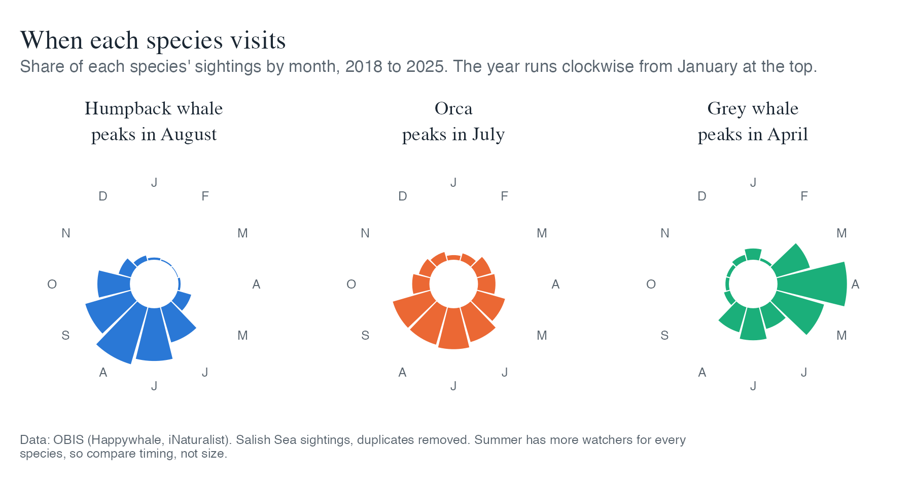
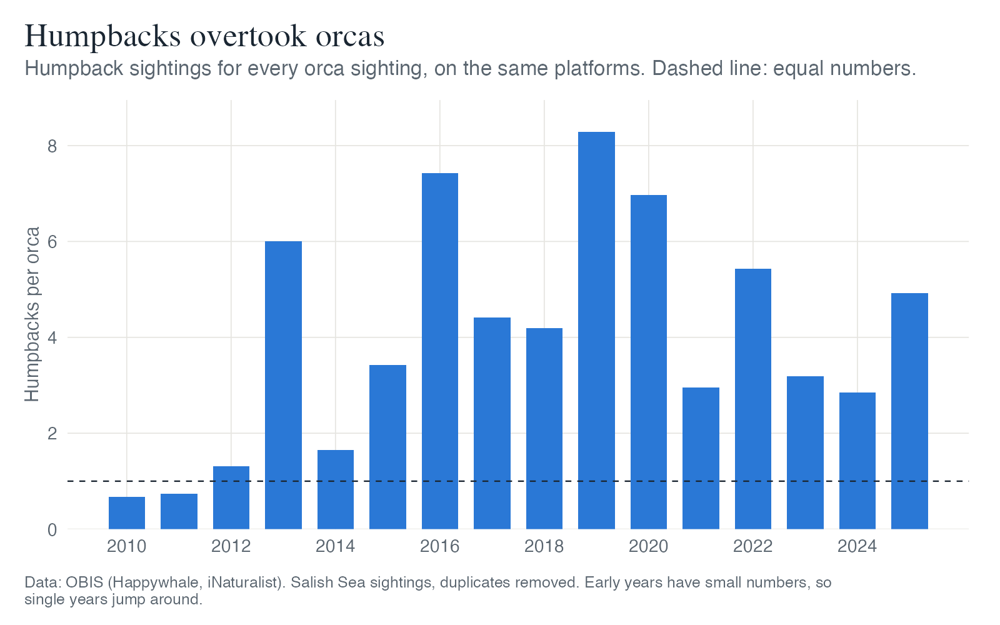

```{r setup}
library(tidyverse)
library(here)

whales <- readRDS(here("data", "processed", "whales.rds"))
effort <- readRDS(here("data", "processed", "effort_by_year.rds"))
story  <- readRDS(here("data", "processed", "story_data.rds"))
n_raw  <- nrow(readRDS(here("data", "raw", "obis_whales_raw.rds")))

last_full_year <- as.integer(format(Sys.Date(), "%Y")) - 1
fmt <- function(x) format(round(x), big.mark = ",")

# Watchers and humpbacks, growth since 2015
inat <- effort$inat_effort
watchers_x <- with(inat, inat_records[year == last_full_year] / inat_records[year == 2015])
hump <- effort$ratio
humpback_x <- with(hump, `Humpback whale`[year == last_full_year] / `Humpback whale`[year == 2015])

# Humpbacks per 1,000 iNaturalist observations
rate <- effort$effort |> filter(common == "Humpback whale")
rate_2015 <- rate$per_1000_observations[rate$year == 2015]
rate_recent <- mean(rate$per_1000_observations[rate$year %in% (last_full_year - 1):last_full_year])

# Calendar shares
cal <- story$calendar
share <- function(sp, months) round(100 * sum(cal$share[cal$common == sp & cal$month %in% months]))
grey_spring  <- share("Grey whale", 3:5)
hump_summer  <- share("Humpback whale", 6:10)
```

## A year in the Salish Sea

Each dot below is a whale sighting, pooled across 2018 to `r last_full_year` and sorted by month. Press play, or drag the slider, and switch species on and off with the buttons above the map.

```{=html}
<iframe class="whale-frame" id="whale-map" src="story/year-in-salish-sea.html"
        title="Interactive map of whale sightings in the Salish Sea by month" loading="lazy"></iframe>
<script>
  /* The map reports its own height, so the frame fits it exactly */
  window.addEventListener("message", function (e) {
    if (e.data && e.data.whaleMapHeight) {
      document.getElementById("whale-map").style.height = e.data.whaleMapHeight + "px";
    }
  });
</script>
```

## When each species visits

{fig-alt="Three circular month charts. Humpback whale sightings peak in August, orca sightings are spread from May to September with a July peak, and grey whale sightings peak in April."}

The three species keep very different calendars.

- **Grey whales are a spring story.** `r grey_spring`% of their sightings fall between March and May, and most are in one corner of northern Puget Sound. That fits the "Sounders", a small group of grey whales that [leave their northward migration to feed on ghost shrimp for two to three months each spring](https://cascadiaresearch.org/?p=3374), around Whidbey and Camano Islands.
- **Humpbacks arrive in summer and leave in autumn.** `r hump_summer`% of their sightings fall between June and October, mostly in Juan de Fuca Strait and the central Strait of Georgia.
- **Orcas are the most year-round of the three.** They peak from May to September but turn up in every month.

## Listen

Whales are easier to hear than to see. Press a sound to play it, and watch it draw itself as a spectrogram. Orca calls sit high and sharp, humpback song lower and slower, and ship noise spreads across the same low pitches humpbacks use. Headphones help, especially for the humpbacks.

```{=html}
<iframe class="whale-frame listen-frame" id="listen-widget" src="story/listen.html"
        title="Whale sounds with a live spectrogram" loading="lazy"></iframe>
<script>
  window.addEventListener("message", function (e) {
    if (e.data && e.data.listenHeight) {
      document.getElementById("listen-widget").style.height = e.data.listenHeight + "px";
    }
  });
</script>
```

## Whales in the traffic

Switch on **Ferry routes** and **Shipping lanes** on the map above to see the boat traffic whales share the sea with.

Ferry routes and shipping lanes, plus 2 km either side, cover about a third of the Salish Sea. About half of all whale sightings fall in that zone. So whales turn up near busy routes a little more than the area alone predicts, but not dramatically.

- **Humpbacks are seen near shipping lanes 1.7 times as often as chance would suggest.** The lanes run through Juan de Fuca Strait, the humpbacks' busiest feeding area, which is why ship strikes are a concern.
- **Orcas are seen near ferry routes 1.7 times as often.** Some of that is where orcas travel, and some is that a ferry is a floating viewing deck full of people with phones.
- **Grey whales mostly stay out of the shipping lanes** (0.6 times), feeding in shallow bays instead.

As with everything else here, these are sightings, so they show where whales and watchers overlap, not where whales are.

## More whales, or more watchers?

:::::: {.cr-section}

Humpback whale sightings in these records went from a few dozen a year around 2010 to more than 2,000 in `r last_full_year`. It looks like a population explosion. @cr-watchers

But sightings measure people as well as whales. Since 2015, iNaturalist records of marine life in the Salish Sea have grown about `r round(watchers_x)` times. Humpback sightings grew about `r round(humpback_x)` times. The watchers grew faster than the whales. @cr-watchers

So one fair comparison is whale sightings **per 1,000 iNaturalist marine observations**. If people simply log more of everything, that rate stays flat. @cr-rate

For humpbacks it did not stay flat. It rose from about `r round(rate_2015, 1)` per 1,000 in 2015 to about `r round(rate_recent, 1)` in the last two years. Orca and grey whale rates drifted down over the same period. @cr-rate

That drift is expected: as more people use iNaturalist, they log more tide pools, birds, and seaweed, which dilutes every whale rate. A humpback rate that climbs anyway is a strong signal. @cr-rate

Look at 2020. iNaturalist records nearly doubled while every whale rate hit its lowest point. A likely explanation is that whale-watching boats largely stopped during the pandemic while beachcombing boomed. @cr-rate

A second comparison uses orcas as a yardstick, because the same people on the same platforms report both. In 2010 and 2011 there were fewer humpback sightings than orca sightings. Since 2015 there have been three to eight humpbacks for every orca. @cr-orca

This comparison is conservative. Sightings of Bigg's (mammal-eating) killer whales have [risen too, tied to a growing harbour seal population](https://www.cbc.ca/1.7295135), so humpbacks have outpaced a rising yardstick. @cr-orca

:::{#cr-watchers}
{fig-alt="Line chart on a multiplier scale. Since 2015, iNaturalist marine observations in the Salish Sea grew about 32 times, while humpback whale sightings grew about 12 times."}
:::

:::{#cr-rate}
{fig-alt="Line chart of whale sightings per 1,000 iNaturalist marine observations from 2015. Humpbacks rise from about 3 to about 8 or 9, orcas fall, and grey whales stay low. 2020 is the lowest year for all three."}
:::

:::{#cr-orca}
{fig-alt="Bar chart of humpback sightings per orca sighting each year since 2010. Below 1 in 2010 and 2011, then between 3 and 8 from 2015 onward."}
:::

::::::

## So, which is it?

Both, but not equally. Most of the jump in raw sightings comes from more people looking. Once that is allowed for, humpbacks still rose, both against the background of everything people record and against orcas.

That matches what whale researchers report from direct photo-identification. The Seattle Times describes humpbacks in the Salish Sea recovering [at about 8% a year](https://www.spokesman.com/stories/2026/may/17/how-the-humpback-whale-made-a-massive-comeback-in-/), and [about 500 individual humpbacks](https://www.cbc.ca/1.6221049) have been documented in the region in recent years, after the population was wiped out by whaling in the early 1900s.

The broader lesson applies well beyond whales. Whenever counts come from people choosing to report them, a rise in reports is partly a rise in reporting. The fix is the same as in public health surveillance: find a measure of effort, or a comparison group seen by the same observers, and look at rates rather than raw counts.

## How this was made

- **Data.** Occurrence records for humpback whales, orcas (killer whales), and grey whales, downloaded from [OBIS](https://obis.org) with the robis R package. The largest sources are Happywhale, iNaturalist research-grade observations, and the BC Cetacean Sightings Network.
- **Cleaning.** `r fmt(n_raw)` records were downloaded. Records on land, records outside an approximate Salish Sea boundary, and likely duplicates (the same species, on the same day, within about 1 km) were removed, leaving `r fmt(nrow(whales))` sightings. Happywhale records one row per identified whale, so a group of four humpbacks becomes one sighting here.
- **Effort.** The number of iNaturalist research-grade marine observations inside the boundary each year, from the OBIS statistics service.
- **Tools.** R (tidyverse, sf, robis), D3 for the interactive map, and Quarto with the closeread extension for this page. The code is [on GitHub](https://github.com/emmabranch/salish-sea-whales).

## Data credits

::: {.source-list}
- Ocean Biodiversity Information System (OBIS), Intergovernmental Oceanographic Commission of UNESCO. www.obis.org. Accessed November 2026.
- Contributing datasets include Happywhale, iNaturalist research-grade observations, and British Columbia Cetacean Sightings Network observations, as published through OBIS.
- Coastline: Statistics Canada, 2021 Census cartographic boundary file (provinces and territories), under the Open Government Licence (Canada); and US Census Bureau cartographic boundary file (states, 1:500,000).
- Sounds: orca calls, US National Park Service, Glacier Bay National Park (public domain, via Wikimedia Commons); humpback song, NOAA Northeast Fisheries Science Center, Passive Acoustics Branch, [Sounds in the Ocean](https://www.fisheries.noaa.gov/national/science-data/sounds-ocean-mammals) (public domain); humpback with a ship, [NOAA Pacific Marine Environmental Laboratory](https://pmel.noaa.gov/acoustics/multimedia.html) (public information).
- Ferry routes and shipping lanes: © OpenStreetMap contributors, under the Open Database Licence (ODbL), via the Overpass API.
:::
