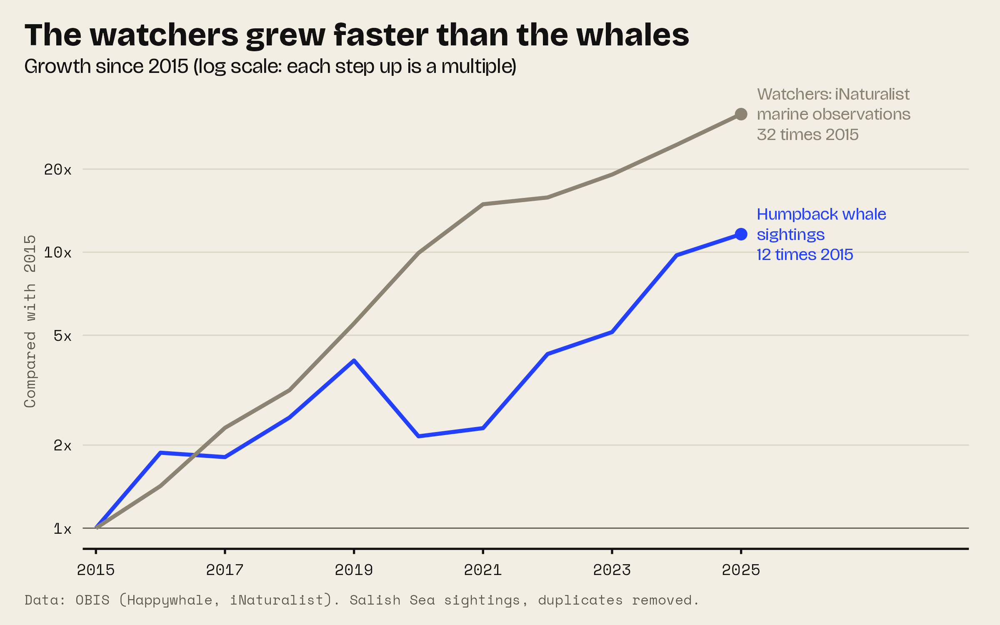
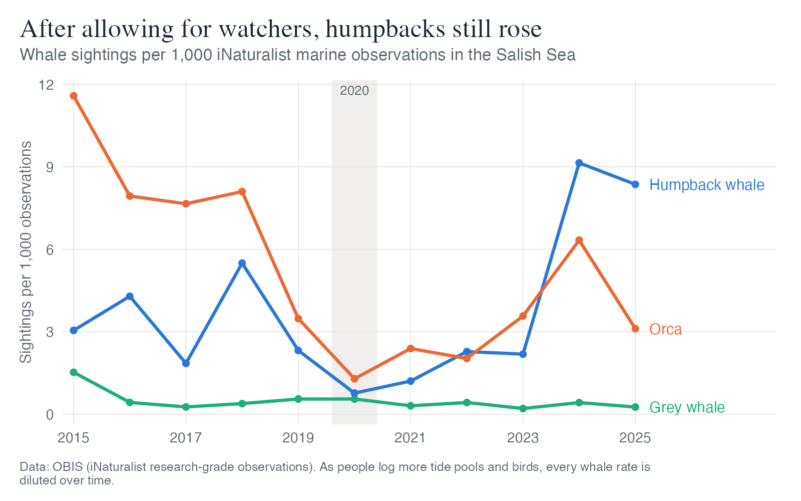

```{r setup}
source(here::here("R", "page_setup.R"))
source(here::here("R", "hero_stripes.R"))
```

::::: {.hero-full .column-screen}

```{r hero-bg}
#| output: asis
cat(hero_stripes(whales, last_full_year))
```

:::: {.hero-inner}

[Portfolio project · R · D3 · open data]{.eyebrow}

# More whales, or more watchers? [What 13,000 sightings say about the Salish Sea.]{.accent}

Whale sightings in the Salish Sea have soared. Some of that is whales, and some of it is people with phones. This story untangles the two, using open records of humpback whales, orcas, and grey whales.

[Read the story](#more-whales-or-more-watchers){.btn .btn-accent} [Explore the map](map.qmd){.btn .btn-ghost} [Code on GitHub](https://github.com/emmabranch/salish-sea-whales){.btn .btn-ghost}

[Background: one stripe per year since 2000, brighter in years with more humpback whale sightings. Data: OBIS (Ocean Biodiversity Information System), 1971 to 2026, Salish Sea only.]{.hero-note}

::::

```{=html}
<svg class="hero-wave" viewBox="0 0 1440 80" preserveAspectRatio="none" aria-hidden="true"><path d="M0,40 C240,80 480,0 720,30 C960,60 1200,10 1440,40 L1440,80 L0,80 Z"></path></svg>
```

:::::

```{r stats}
#| output: asis
cat(sprintf('<div class="stat-row lift">
<div class="stat-box"><span class="num">%s</span><span class="lab">whale sightings after cleaning</span></div>
<div class="stat-box"><span class="num">%s&times;</span><span class="lab">growth in iNaturalist marine records, 2015 to %s</span></div>
<div class="stat-box"><span class="num">%s&times;</span><span class="lab">growth in humpback sightings over the same years</span></div>
</div>', fmt(nrow(whales)), round(watchers_x), last_full_year, round(humpback_x)))
```

## More whales, or more watchers?

Scroll down. The chart changes as you read.

:::::: {.cr-section}

Humpback whale sightings in these records went from a few dozen a year around 2010 to more than 2,000 in `r last_full_year`. It looks like a population explosion. @cr-watchers

But sightings measure people as well as whales. Since 2015, iNaturalist records of marine life in the Salish Sea have grown about `r round(watchers_x)` times. Humpback sightings grew about `r round(humpback_x)` times. The watchers grew faster than the whales. @cr-watchers

So one fair comparison is whale sightings **per 1,000 iNaturalist marine observations**. If people simply log more of everything, that rate stays flat. @cr-rate

For humpbacks it did not stay flat. It rose from about `r round(rate_2015, 1)` per 1,000 in 2015 to about `r round(rate_recent, 1)` in the last two years. Orca and grey whale rates drifted down over the same period. @cr-rate

That drift is expected: as more people use iNaturalist, they log more tide pools, birds, and seaweed, which dilutes every whale rate. A humpback rate that climbs anyway is a strong signal. @cr-rate

Look at 2020. iNaturalist records nearly doubled while every whale rate hit its lowest point. A likely explanation is that whale-watching boats largely stopped during the pandemic while beachcombing boomed. @cr-rate

A second comparison uses orcas as a yardstick, because the same people on the same platforms report both. In 2010 and 2011 there were fewer humpback sightings than orca sightings. Since 2015 there have been three to eight humpbacks for every orca. @cr-orca

This comparison is conservative. Sightings of Bigg's (mammal-eating) killer whales have [risen too, tied to a growing harbour seal population](https://www.cbc.ca/1.7295135), so humpbacks have outpaced a rising yardstick. @cr-orca

:::{#cr-watchers}
{fig-alt="Line chart on a multiplier scale. Since 2015, iNaturalist marine observations in the Salish Sea grew about 32 times, while humpback whale sightings grew about 12 times."}
:::

:::{#cr-rate}
{fig-alt="Line chart of whale sightings per 1,000 iNaturalist marine observations from 2015. Humpbacks rise from about 3 to about 8 or 9, orcas fall, and grey whales stay low. 2020 is the lowest year for all three."}
:::

:::{#cr-orca}
{fig-alt="Bar chart of humpback sightings per orca sighting each year since 2010. Below 1 in 2010 and 2011, then between 3 and 8 from 2015 onward."}
:::

::::::

## So, which is it?

Both, but not equally. Most of the jump in raw sightings comes from more people looking. Once that is allowed for, humpbacks still rose, both against the background of everything people record and against orcas.

That matches what whale researchers report from direct photo-identification. The Seattle Times describes humpbacks in the Salish Sea recovering [at about 8% a year](https://www.spokesman.com/stories/2026/may/17/how-the-humpback-whale-made-a-massive-comeback-in-/), and [about 500 individual humpbacks](https://www.cbc.ca/1.6221049) have been documented in the region in recent years, after the population was wiped out by whaling in the early 1900s.

The broader lesson applies well beyond whales. Whenever counts come from people choosing to report them, a rise in reports is partly a rise in reporting. The fix is the same as in public health surveillance: find a measure of effort, or a comparison group seen by the same observers, and look at rates rather than raw counts.

## Keep exploring

- **[Map](map.qmd):** a year of sightings month by month, which seasons each species visits, and how close whales come to ferry routes and shipping lanes.
- **[Listen](listen.qmd):** orca calls, humpback song, and a humpback with a ship, drawn as live spectrograms.
- **[About the data](about.qmd):** how the sightings were cleaned, and where every dataset comes from.
