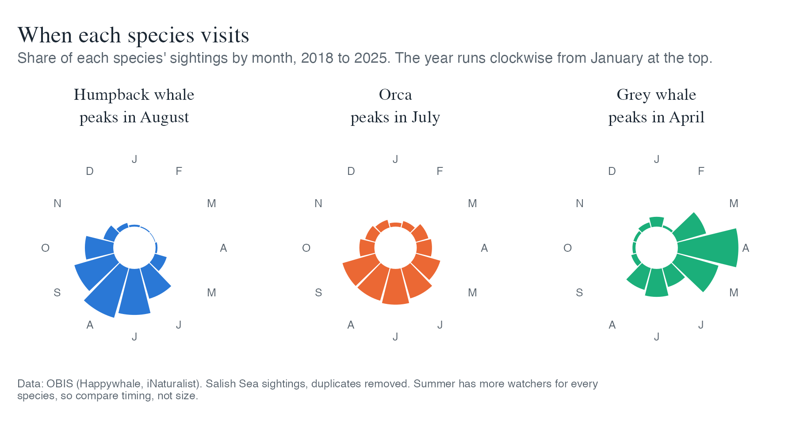

```{r setup}
source(here::here("R", "page_setup.R"))
```

## A year in the Salish Sea

Each dot below is a whale sighting, pooled across 2018 to `r last_full_year` and sorted by month. Press play, or drag the slider, and switch species on and off with the buttons next to the map.

::: {.column-page}
```{=html}
<iframe class="whale-frame" id="whale-map" src="story/year-in-salish-sea.html"
        title="Interactive map of whale sightings in the Salish Sea by month" loading="lazy"></iframe>
<script>
  /* The map reports its own height, so the frame fits it exactly */
  window.addEventListener("message", function (e) {
    if (e.data && e.data.whaleMapHeight) {
      document.getElementById("whale-map").style.height = e.data.whaleMapHeight + "px";
    }
  });
</script>
```
:::

## Whales in the traffic

Switch on **Ferry routes** and **Shipping lanes** on the map at the top of this page to see the boat traffic whales share the sea with.

Ferry routes and shipping lanes, plus 2 km either side, cover about a third of the Salish Sea. About half of all whale sightings fall in that zone. So whales turn up near busy routes a little more than the area alone predicts, but not dramatically.

- **Humpbacks are seen near shipping lanes 1.7 times as often as chance would suggest.** The lanes run through Juan de Fuca Strait, the humpbacks' busiest feeding area, which is why ship strikes are a concern.
- **Orcas are seen near ferry routes 1.7 times as often.** Some of that is where orcas travel, and some is that a ferry is a floating viewing deck full of people with phones.
- **Grey whales mostly stay out of the shipping lanes** (0.6 times), feeding in shallow bays instead.

As with everything else here, these are sightings, so they show where whales and watchers overlap, not where whales are.

## When each species visits

{fig-alt="Three circular month charts. Humpback whale sightings peak in August, orca sightings are spread from May to September with a July peak, and grey whale sightings peak in April."}

The three species keep very different calendars.

- **Grey whales are a spring story.** `r grey_spring`% of their sightings fall between March and May, and most are in one corner of northern Puget Sound. That fits the "Sounders", a small group of grey whales that [leave their northward migration to feed on ghost shrimp for two to three months each spring](https://cascadiaresearch.org/?p=3374), around Whidbey and Camano Islands.
- **Humpbacks arrive in summer and leave in autumn.** `r hump_summer`% of their sightings fall between June and October, mostly in Juan de Fuca Strait and the central Strait of Georgia.
- **Orcas are the most year-round of the three.** They peak from May to September but turn up in every month.
